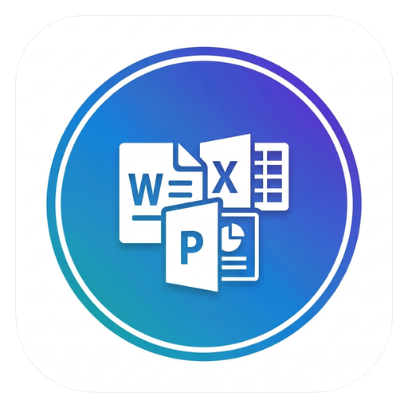

  

<h1 align="center">Yomi-Office Open Source</h1>

  

  Bộ ứng dụng văn phòng mã nguồn mở, miễn phí, chạy <b>ngoại tuyến</b> trên <b>Android 6.0+</b> và <b>Windows 7+</b>:
  Word · Excel · PowerPoint · PDF · CamScanner · MathType · Trợ lý A.I
   
  <a href="https://yomihub-project.github.io/Yomi-Office-Open-Source/">Trang chủ</a> ·
  <a href="https://yomihub-project.github.io/Yomi-Office-Open-Source/privacy.html">Chính sách quyền riêng tư</a>

---

## 📝 Mục lục
- [Giới thiệu](#-giới-thiệu)
- [Tính năng](#-tính-năng)
- [Cài đặt](#-cài-đặt)
- [Sử dụng](#-sử-dụng)
- [Kiểm thử](#-kiểm-thử)
- [Công nghệ](#️-công-nghệ)
- [Tác giả](#️-tác-giả)
- [Ghi nhận](#-ghi-nhận)

## 🧐 Giới thiệu
**Yomi-Office Open Source** là bộ ứng dụng văn phòng mở trọn vẹn tệp Microsoft Office (.docx, .xlsx, .pptx, .doc, .xls, .ppt, .xlsm…) và OpenDocument (.odt, .ods, .odp) ngay trên điện thoại Android và máy tính Windows. Ứng dụng có hai engine: trình soạn thảo riêng (gọn nhẹ, chạy được trên Android 6.0) và engine Native dựa trên LibreOffice để hiển thị đúng chuẩn Microsoft Office. Mọi tính năng chính hoạt động **không cần Internet**, dữ liệu nằm trên máy của bạn.

## ✨ Tính năng
| Ứng dụng | Tính năng chính |
|---|---|
| **Word** | Soạn thảo đầy đủ Ribbon, thước kẻ, phân trang & ngắt trang thật, phối thư (Mail Merge) từ Excel, mục lục, chú thích, phương trình, macro VBA (.docm) |
| **Excel** | Hơn 500 hàm Excel 365 (XLOOKUP, LAMBDA, SEQUENCE, PIVOTBY…), hàm liên kết nhiều sheet / 3D / nhiều bảng tính `[Book.xlsx]Sheet!A1`, PivotTable, định dạng có điều kiện, xác thực dữ liệu, ngắt trang, VBA & macro (.xlsm), JSA kiểu WPS |
| **PowerPoint** | Trình chiếu, chuyển tiếp & hoạt hình ghi vào .pptx, ghi âm thuyết minh, VBA (.pptm), mẫu slide |
| **PDF** | Đọc, chú thích, ký, đặt/gỡ mật khẩu, nén, ghép tệp, tách ảnh, ảnh ↔ PDF, PDF → Word/PowerPoint/Excel/PDF-A, **OCR tiếng Việt + tiếng Anh ngoại tuyến** |
| **CamScanner** | Chụp tài liệu, tự nhận mép giấy, nắn phối cảnh, lọc đen trắng, xuất PDF |
| **MathType** | Soạn công thức LaTeX / MathML, chèn vào Word & PowerPoint |
| **Trợ lý A.I** | Ngoại tuyến; Web không cần đăng nhập (ChatGPT, Copilot, Grok…) hoặc có đăng nhập (Gemini, Claude, DeepSeek); khóa API được lưu trên máy (OpenAI, Anthropic, Gemini, DeepSeek, Groq, OpenRouter, xAI, Azure); **Free Claude Code** (proxy miễn phí), Ollama, LM Studio |
| **Tệp trên máy** | Tự quét và liệt kê mọi tệp Word / Excel / PowerPoint trên thiết bị (tab *Trên thiết bị*) |
| **Đám mây** | Google Drive, OneDrive, Dropbox, MediaFire; phát hiện xung đột khi nhiều người cùng sửa |
| **DeX & TV** | Giao diện máy tính trên Samsung DeX, trình chiếu lên TV / màn hình thứ hai, Quick Share |
| **Cập nhật** | Tự kiểm tra bản mới trên GitHub Releases (và Google Drive, MediaFire), tải & cài tự động |

## 🏁 Cài đặt
Bấm **[⬇️ Tải về](https://github.com/YomiHub-Project/Yomi-Office-Open-Source/releases/latest)** rồi chọn tệp phù hợp với máy:

**Android** — chọn theo phiên bản Android và loại CPU (đa số điện thoại hiện nay là `arm64-v8a`; máy cũ 32-bit là `armeabi-v7a`; máy ảo/Chromebook Intel là `x86_64`):

| Phiên bản Android | arm64-v8a | armeabi-v7a | x86_64 |
|---|---|---|---|
| Android 10 trở lên | [APK](https://github.com/YomiHub-Project/Yomi-Office-Open-Source/releases/download/v0.1.8/Yomi-Office-Open-Source-0.1.8-Android10plus-arm64-v8a.apk) | [APK](https://github.com/YomiHub-Project/Yomi-Office-Open-Source/releases/download/v0.1.8/Yomi-Office-Open-Source-0.1.8-Android10plus-armeabi-v7a.apk) | [APK](https://github.com/YomiHub-Project/Yomi-Office-Open-Source/releases/download/v0.1.8/Yomi-Office-Open-Source-0.1.8-Android10plus-x86_64.apk) |
| Android 8.0 – 9 | [APK](https://github.com/YomiHub-Project/Yomi-Office-Open-Source/releases/download/v0.1.8/Yomi-Office-Open-Source-0.1.8-Android8-9-arm64-v8a.apk) | [APK](https://github.com/YomiHub-Project/Yomi-Office-Open-Source/releases/download/v0.1.8/Yomi-Office-Open-Source-0.1.8-Android8-9-armeabi-v7a.apk) | [APK](https://github.com/YomiHub-Project/Yomi-Office-Open-Source/releases/download/v0.1.8/Yomi-Office-Open-Source-0.1.8-Android8-9-x86_64.apk) |
| Android 6.0 – 7.1 | [APK](https://github.com/YomiHub-Project/Yomi-Office-Open-Source/releases/download/v0.1.8/Yomi-Office-Open-Source-0.1.8-Android6-7-arm64-v8a.apk) | [APK](https://github.com/YomiHub-Project/Yomi-Office-Open-Source/releases/download/v0.1.8/Yomi-Office-Open-Source-0.1.8-Android6-7-armeabi-v7a.apk) | [APK](https://github.com/YomiHub-Project/Yomi-Office-Open-Source/releases/download/v0.1.8/Yomi-Office-Open-Source-0.1.8-Android6-7-x86_64.apk) |

**Windows** — `Setup.exe` (cài đặt), `.msi` (cài đặt doanh nghiệp/GPO), `portable.zip` (không cần cài: giải nén rồi chạy):

| Windows | Setup .exe | .msi | Portable .zip |
|---|---|---|---|
| Windows 10/11 x64 | [tải](https://github.com/YomiHub-Project/Yomi-Office-Open-Source/releases/download/v0.1.8/Yomi-Office-Open-Source-0.1.8-Win10-11-x64-Setup.exe) | [tải](https://github.com/YomiHub-Project/Yomi-Office-Open-Source/releases/download/v0.1.8/Yomi-Office-Open-Source-0.1.8-Win10-11-x64.msi) | [tải](https://github.com/YomiHub-Project/Yomi-Office-Open-Source/releases/download/v0.1.8/Yomi-Office-Open-Source-0.1.8-Win10-11-x64-portable.zip) |
| Windows 10/11 x86 | [tải](https://github.com/YomiHub-Project/Yomi-Office-Open-Source/releases/download/v0.1.8/Yomi-Office-Open-Source-0.1.8-Win10-11-x86-Setup.exe) | [tải](https://github.com/YomiHub-Project/Yomi-Office-Open-Source/releases/download/v0.1.8/Yomi-Office-Open-Source-0.1.8-Win10-11-x86.msi) | [tải](https://github.com/YomiHub-Project/Yomi-Office-Open-Source/releases/download/v0.1.8/Yomi-Office-Open-Source-0.1.8-Win10-11-x86-portable.zip) |
| Windows 10/11 ARM64 | [tải](https://github.com/YomiHub-Project/Yomi-Office-Open-Source/releases/download/v0.1.8/Yomi-Office-Open-Source-0.1.8-Win10-11-ARM64-Setup.exe) | [tải](https://github.com/YomiHub-Project/Yomi-Office-Open-Source/releases/download/v0.1.8/Yomi-Office-Open-Source-0.1.8-Win10-11-ARM64.msi) | [tải](https://github.com/YomiHub-Project/Yomi-Office-Open-Source/releases/download/v0.1.8/Yomi-Office-Open-Source-0.1.8-Win10-11-ARM64-portable.zip) |
| Windows 7/8.1 x64 | [tải](https://github.com/YomiHub-Project/Yomi-Office-Open-Source/releases/download/v0.1.8/Yomi-Office-Open-Source-0.1.8-Win7-8.1-x64-Setup.exe) | [tải](https://github.com/YomiHub-Project/Yomi-Office-Open-Source/releases/download/v0.1.8/Yomi-Office-Open-Source-0.1.8-Win7-8.1-x64.msi) | [tải](https://github.com/YomiHub-Project/Yomi-Office-Open-Source/releases/download/v0.1.8/Yomi-Office-Open-Source-0.1.8-Win7-8.1-x64-portable.zip) |
| Windows 7/8.1 x86 | [tải](https://github.com/YomiHub-Project/Yomi-Office-Open-Source/releases/download/v0.1.8/Yomi-Office-Open-Source-0.1.8-Win7-8.1-x86-Setup.exe) | [tải](https://github.com/YomiHub-Project/Yomi-Office-Open-Source/releases/download/v0.1.8/Yomi-Office-Open-Source-0.1.8-Win7-8.1-x86.msi) | [tải](https://github.com/YomiHub-Project/Yomi-Office-Open-Source/releases/download/v0.1.8/Yomi-Office-Open-Source-0.1.8-Win7-8.1-x86-portable.zip) |

Gói Microsoft Store `.appxbundle` (Windows 10 1809+ / 11): xem trang [Releases](https://github.com/YomiHub-Project/Yomi-Office-Open-Source/releases/latest).

## 🎈 Sử dụng
- Mở tệp từ trình quản lý tệp, email, Zalo… hoặc từ tab **Gần đây / Đã ghim / Trên thiết bị** trên màn hình chính.
- **Tùy chọn → Cập nhật phần mềm**: kiểm tra và cài bản mới.
- **Trợ lý A.I → ⚙️**: chọn dịch vụ, nhập khóa API (lưu trên máy) hoặc địa chỉ proxy Free Claude Code (mặc định `http://127.0.0.1:8082`).

## 🔧 Kiểm thử
Mỗi bản phát hành được kiểm thử bằng bộ tự kiểm tra tích hợp (mở ứng dụng với `#selftest`, 49 mục: Word, Excel, PowerPoint, PDF, OCR, VBA, ODF, đám mây, A.I…) trên Android 6, Android 14, thiết bị thật Samsung Galaxy Note 9, và các bản Windows; tệp mẫu được so sánh với Microsoft Office.

## ⛏️ Công nghệ
JavaScript (ES2017 → ES5 cho Android 6), esbuild, Babel · Android (Java, WebView) · Windows (C#, WebView2) · [LibreOffice](https://www.libreoffice.org/) (LibreOfficeKit) · [pdf-lib](https://pdf-lib.js.org/) · [Tesseract](https://github.com/tesseract-ocr/tesseract) · [KaTeX](https://katex.org/) · [Formula.js](https://formulajs.info/) · WiX Toolset

## ✍️ Tác giả
- **YomiHub Project** ([@kiritokmn1403](https://github.com/kiritokmn1403)) — chủ dự án.
- Phát triển với sự hỗ trợ của Claude (Anthropic) và Google Antigravity.

## 🎉 Ghi nhận
Cảm ơn các dự án mã nguồn mở LibreOffice, Apache OpenOffice, ONLYOFFICE, Apache POI, OOXML/ODF, Formula.js, pdf-lib, Tesseract, KaTeX, Free Claude Code và hàng trăm dự án trong danh sách tham chiếu của YomiHub.
